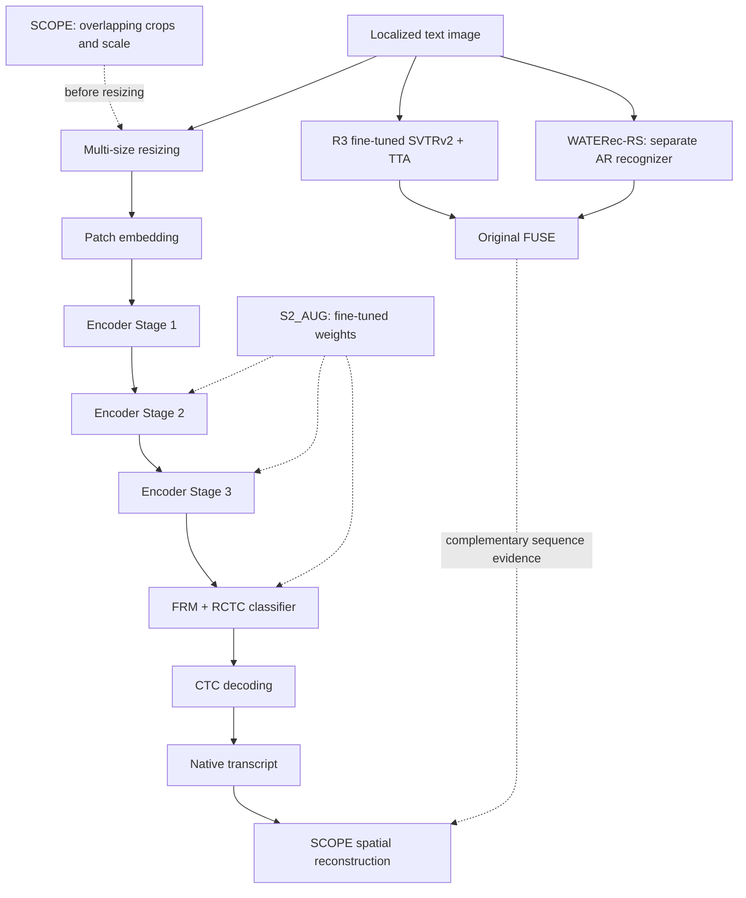
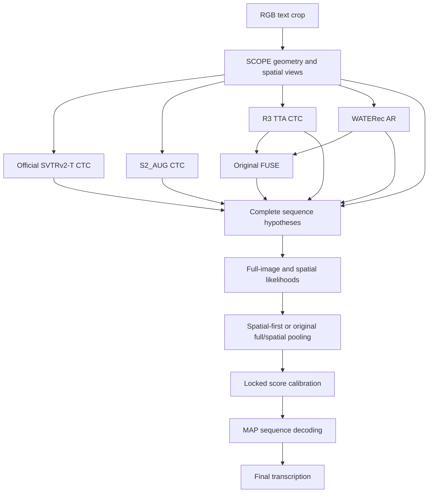

# Enhanced SVTRv2 for Challenging Scene Text Recognition

**CS406 course project — Global CTC–AR hypothesis decoding with spatial-first evidence fusion**

This repository extends the official SVTRv2-T recognizer to address three complementary challenges: long text, motion blur and artistic typography. The proposed integration reuses frozen recognizers and the original spatial reconstruction algorithm. It evaluates complete transcription hypotheses using CTC and autoregressive (AR) likelihoods over full-image and overlapping spatial views. It does not classify images by degradation type, train a new backbone or merge incompatible checkpoint tensors.

**Release status:** research release candidate. Global and Spatial-first have completed the full six-condition GPU benchmark: 9,289 observations, 9,287 scored. Spatial-first is the proposed release method. The additive inference API/CLI still needs a separate deployment smoke test. The existing stable modes remain unchanged. No claim of independent state-of-the-art performance is made.

## Contents

- [Architecture and contributions](#architecture-and-contributions)
- [Method](#method)
- [Experimental results](#experimental-results)
- [Installation and inference](#installation-and-inference)
- [Full benchmark](#full-benchmark)
- [Repository layout](#repository-layout)
- [Limitations and reproducibility](#limitations-and-reproducibility)

## Architecture and contributions

The input is a **localized word or text-line RGB crop**; detection and full-page layout analysis are not included. The original SVTRv2 inference path consists of multi-size resizing (MSR), patch embedding, visual encoder stages 1–3, feature rearrangement (FRM), CTC classification and decoding. Semantic guidance is a training-time mechanism in the upstream model.



This intervention diagram locates each contribution relative to SVTRv2; it is **not** a claim that the Motion and Artistic weights are merged into the same encoder. The actual integration below runs separate frozen recognizers.

| Contribution | Intervention | Role at inference |
|---|---|---|
| [SCOPE-CTC V4](experiments/long-text-recognition/) | Before MSR and after CTC | Coverage/orientation, overlapping crops, cross-scale verification and reconstruction; official weights frozen |
| [S2_AUG](experiments/danh_motion_blur/) | Training-time motion augmentation; Stage 2, Stage 3 and RCTC fine-tuning | Blur-robust SVTRv2 checkpoint, without blurring input during inference |
| [Artistic FUSE](experiments/truc_artistic_font/) | R3 fine-tuning, ratio/rotation TTA, independent WATERec-RS AR model | Complementary CTC/AR evidence and original FUSE transcript |
| Global CTC–AR | Common sequence-level inference | Retains complete hypotheses, evaluates full/spatial evidence, calibrates and decodes |



## Method

1. **Spatial representation:** original SCOPE captures the native prediction, ordered crop spans, multi-scale CTC evidence and reconstructed transcript. Full-image evidence remains available.
2. **Frozen recognition:** official SVTRv2, S2_AUG, R3 and WATERec provide full-image and crop-level evidence. R3's true TTA winner is used for full sequence scoring; unrotated logits are used for geometric stitching.
3. **Global hypotheses:** retain native, specialist, FUSE, SCOPE(S2_AUG), beam/stitch and joint reconstruction candidates. All candidates are generated from the image, never from ground truth. The search is bounded, not exhaustive lattice decoding.
4. **Likelihood:** exact CTC forward marginal for each supported raw spelling/case variant; AR conditional token likelihood including EOS from the real WATERec decoder. Finite raw variants are grouped into normalized candidates. Projection onto SCOPE character positions uses minimum-edit alignment; overlap-aware weights combine spatial views. These are approximate composite likelihoods and candidate-conditional probabilities.
5. **Spatial-first:** for each recognizer use its spatial distribution when available, otherwise its full-image distribution. The original Global instead averages available full and spatial distributions. R3 and WATERec are averaged into the Artistic source before combining the three source families.
6. **Calibrated MAP:** temperature-scale the three distributions and pool with frozen source weights. Select the maximum-posterior candidate. MBR is an optional diagnostic, not a mandatory second decoder.

For a raw candidate sequence y, CTC sums probabilities over paths collapsing to y. AR multiplies conditional next-token probabilities through EOS. For each source distribution q, temperature scaling is `softmax(log(q) / T)`. The final posterior is the weighted mixture of the available distributions (weights renormalized if a source is unavailable).

| Source family | Weight | Temperature |
|---|---:|---:|
| Native / spatial | 0.045001 | 2.089807 |
| Motion | 0.122965 | 0.160345 |
| Artistic | 0.832034 | 0.694290 |

The five scalar degrees of freedom were fitted by conditional NLL on 240 historical development observations (213 supported, 139 supported source groups). All recognizer weights are frozen; this is supervised score calibration, not end-to-end retraining. Spatial-first reuses the same locked parameters without refitting.

## Experimental results

**Primary baseline: official SVTRv2-T (B0).** Accuracy is normalized exact match; CER is total Levenshtein edits divided by total normalized ground-truth characters. Empty normalized labels are excluded; empty predictions on valid labels count as errors. Evaluation normalizes by `casefold()` and keeps alphanumeric characters. All percentages below are on matched observations. Controlled blur is a separate derived cohort, not the original three blur-factor sets.

### Full benchmark — primary results (GPU, run `20261125T030112Z`)

| Dataset / condition | Scored | B0 Acc. (%) | Ours Acc. (%) | B0 CER (%) | Ours CER (%) | Gains / harms vs B0 |
|---|---:|---:|---:|---:|---:|---:|
| IIIT5K | 3,000 | 98.60 | 99.33 | 0.36 | 0.16 | 27 / 5 |
| Union14M Artistic | 898 | 70.71 | 83.41 | 7.51 | 4.04 | 125 / 11 |
| Motion blur f008 | 200 | 96.50 | 96.50 | 1.01 | 1.01 | 2 / 2 |
| Motion blur f018 | 200 | 91.00 | 94.50 | 3.02 | 2.11 | 8 / 1 |
| Motion blur f030 | 200 | 70.50 | 84.00 | 12.36 | 5.33 | 29 / 2 |
| LTB | 4,789 | 33.85 | 62.12 | 31.25 | 9.00 | 1382 / 28 |
| **Overall (micro)** | 9,287 | 61.70 | 78.11 | 27.68 | 8.05 | 1573 / 49 |

9,289 inputs were processed; two Artistic labels are empty after normalization. The proposed method improves exact match from 5,730 to 7,254 correct observations (+1,524; +16.41 percentage points) and reduces micro CER from 27.68% to 8.05% (52,266 to 15,200 edits over 188,798 characters). Blur f008 is unchanged in aggregate; some individual regressions remain. These are historical corpus results, not independent test results. Blur observations are derived variants, not independent source images.

### Full LTB — matched length breakdown

| Length | n | B0 Acc. | SCOPE Acc. | Ours Acc. | B0 CER | SCOPE CER | Ours CER |
|---|---:|---:|---:|---:|---:|---:|---:|
| 26–35 | 3,376 | 44.31 | 59.36 | 65.64 | 16.83 | 7.17 | 7.31 |
| 36–55 | 1,147 | 10.90 | 49.17 | 55.45 | 38.00 | 8.57 | 9.87 |
| ≥56 | 266 | 0.00 | 44.74 | 46.24 | 90.62 | 12.20 | 15.75 |
| Overall | 4,789 | 33.85 | 56.11 | 62.12 | 31.25 | 8.14 | 9.00 |
| A-Avg | 4,789 | 18.40 | 51.09 | 55.78 | — | — | — |

SCOPE is rerun on the same cohort, distinct from its frozen historical standalone result below. Ours increases full-LTB accuracy to 62.12% (+28.27 points vs B0; 1,382 gains and 28 harms), but SCOPE alone retains lower CER (8.14% vs 9.00%). A-Avg is the unweighted mean of the three length-bin accuracies.

### Coverage ablation and calibration overlap

| Cohort | Scored | B0 Acc. | B0 CER | Global Acc. | Global CER | Spatial-first Acc. | Spatial-first CER |
|---|---:|---:|---:|---:|---:|---:|---:|
| Full corpus | 9,287 | 61.70 | 27.68 | 78.00 | 11.41 | 78.11 | 8.05 |
| Excluding known calibration overlaps | 9,047 | 61.37 | 27.79 | 77.93 | 11.41 | 78.04 | 8.03 |

Spatial-first reduces full-LTB empty predictions from 114 to 55 and full-LTB CER from 12.84% to 9.00% versus original Global. It is a fixed post-hoc pooling policy, with no new fitting in this full run. Removing 240 known calibration-overlap observations leaves 9,047 scored observations; this does not prove independence from other historical tuning or upstream training.

### Runtime and audit

| Dataset | B0 mean / P95 (ms) | Global evidence mean / P95 (ms) |
|---|---:|---:|
| IIIT5K | 9.27 / 10.27 | 685.66 / 1085.60 |
| Union14M Artistic | 10.29 / 13.38 | 853.52 / 1646.23 |
| Motion blur f008 | 9.61 / 10.66 | 666.14 / 1014.18 |
| Motion blur f018 | 9.57 / 11.12 | 663.56 / 1079.77 |
| Motion blur f030 | 9.39 / 10.43 | 707.93 / 1180.47 |
| LTB | 10.24 / 11.50 | 5014.91 / 9033.23 |
| Overall | 9.88 / 11.34 | 2933.48 / 7839.48 |

One T4 is used for inference (two T4s visible). The Global evidence timing includes multiple recognizers and hypothesis scoring, but excludes the final MAP selection and setup; it is not end-to-end deployment latency. Sum of recorded evidence times is 7.57 hours. The computational overhead is substantial.

All six full evaluations completed; the 22 GPU-environment CPU tests passed. The 9,289 independent B0 predictions match the internal B0 trace after normalization. This is not full original V1 parity (skipped). Runtime verified RGB identity for all observations, and reference labels where available (only 240 LTB labels have independent historical reference labels). Expanded resource archive bytes and external source snapshot provenance are not fully verified. The result archive and 10 source/calibration files were checked against the release package, and all aggregate metrics recomputed from the prediction rows. See [metrics](E2E_final/reports/global_release/full_benchmark_metrics.csv), [latency](E2E_final/reports/global_release/full_benchmark_latency.csv) and [audit](E2E_final/reports/global_release/full_benchmark_audit.json).

### Historical development diagnostics — matched 940 observations (640 source images)

Global columns are measured GPU predictions; Spatial-first columns are offline replay with the same candidates, evidence and calibration. The replay reproduces all 1,270 original Global predictions exactly before applying the policy change. These historical replay figures are distinct from the full GPU benchmark above.

| Dataset / condition | n | B0 Acc. | Global Acc. | Spatial-first Acc. | B0 CER | Global CER | Spatial-first CER |
|---|---:|---:|---:|---:|---:|---:|---:|
| IIIT5K | 200 | 97.50 | 98.50 | 98.50 | 0.55 | 0.37 | 0.37 |
| Union14M Artistic | 200 | 69.00 | 81.00 | 80.50 | 8.40 | 4.67 | 4.75 |
| LTB | 240 | 32.50 | 60.83 | 63.33 | 29.79 | 9.23 | 6.65 |
| IIIT5K + controlled blur | 100 | 87.00 | 94.00 | 94.00 | 3.98 | 1.90 | 1.90 |
| Artistic + controlled blur | 100 | 34.00 | 50.00 | 50.00 | 34.30 | 24.76 | 24.76 |
| LTB + controlled blur | 100 | 27.00 | 44.00 | 45.00 | 40.68 | 32.47 | 24.51 |
| **Overall** | 940 | 59.47 | 73.72 | 74.36 | 27.85 | 13.95 | 10.72 |

### Fresh-composition 330 observations (240 source images)

| Dataset / condition | n | B0 Acc. | Global Acc. | Spatial-first Acc. | B0 CER | Global CER | Spatial-first CER |
|---|---:|---:|---:|---:|---:|---:|---:|
| IIIT5K | 80 | 97.50 | 97.50 | 97.50 | 0.48 | 0.48 | 0.48 |
| Union14M Artistic | 80 | 70.00 | 83.75 | 83.75 | 9.43 | 6.50 | 6.50 |
| LTB | 80 | 21.25 | 58.75 | 56.25 | 34.59 | 14.97 | 6.99 |
| IIIT5K + controlled blur | 30 | 93.33 | 100.00 | 100.00 | 1.32 | 0.00 | 0.00 |
| Artistic + controlled blur | 30 | 43.33 | 46.67 | 46.67 | 35.84 | 29.48 | 29.48 |
| LTB + controlled blur | 30 | 23.33 | 30.00 | 30.00 | 41.14 | 33.24 | 23.97 |
| **Overall** | 330 | 60.30 | 74.24 | 73.64 | 29.94 | 16.92 | 10.56 |

The fresh cohort excludes known composition development/evaluation IDs and duplicates, but is not certified independent of the complete project or upstream training. The 940-observation cohort was reused during development. These tables are not full-dataset results. See [measured GPU metrics](E2E_final/reports/global_release/global_gpu_metrics.csv) and [replay metrics](E2E_final/reports/global_release/spatial_first_replay.csv).

### Standalone SCOPE — full LTB (4,789 observations)

These are historical results for SCOPE-CTC V4, not Global or Spatial-first. Accuracy/CER and all length bins are reported in the [standalone artifact](experiments/long-text-recognition/README.md).

| Length | n | B0 Acc. | SCOPE Acc. | B0 CER | SCOPE CER |
|---|---:|---:|---:|---:|---:|
| 26–35 | 3,376 | 44.31 | 59.39 | 16.82 | 7.13 |
| 36–55 | 1,147 | 10.90 | 49.17 | 38.00 | 8.58 |
| ≥56 | 266 | 0.00 | 44.74 | 90.62 | 12.22 |
| Overall | 4,789 | 33.85 | 56.13 | 31.24 | 8.12 |
| A-Avg | — | 18.40 | 51.10 | — | — |

## Installation and inference

The reproducible environment uses Python 3.12, PyTorch 2.5.1 / CUDA 12.1 wheels, torchvision 0.20.1, NumPy 1.26.4 and an NVIDIA GPU. The reference GPU is Tesla T4. The code uses one GPU at a time. A complete original `E2E_repro_v1.zip` (or the corresponding extracted resource directory) is required; no checkpoints or datasets are committed here. Obtain this bundle from the project team under the applicable upstream licenses. Its manifest and checkpoint identities are locked; `E2E_final/release_manifest.json` records expected weights and external revisions. Do not substitute a newer OpenOCR checkout.

The new runtime preparation script reconstructs the byte-exact frozen source in a **new writable workspace**, checks the original manifest, restores model assets and then adds the new modules. It does not overwrite tracked files. Use a workspace outside the checkout and with adequate disk space. For Windows use WSL/Linux for the following commands.

```bash
python3.12 -m venv .venv
source .venv/bin/activate
python -m pip install --index-url https://download.pytorch.org/whl/cu121 torch==2.5.1 torchvision==0.20.1
python -m pip install -r E2E_final/global_release/requirements.txt
python -m pip install --no-deps imgaug==0.4.0
python E2E_final/scripts/prepare_global_runtime.py --bundle /path/to/E2E.zip --work /path/to/new-runtime
cd /path/to/new-runtime/E2E_final
export PYTHONPATH="$PWD/src"
python -m pytest -q tests/test_scope_dispatch.py tests/test_system_dispatch.py tests/global_release
python -m str_e2e.global_cli --config configs/system.local.yaml --image /path/to/text.png --mode global_spatial
```

Python API (after setup, run in the runtime root with `PYTHONPATH=src`):

```python
from PIL import Image
from str_e2e.global_pipeline import GlobalSTRSystem

with GlobalSTRSystem.from_config('configs/system.local.yaml') as system:
    with Image.open('example.png') as image:
        result = system.predict(image.convert('RGB'), mode='global_spatial')
        print(result.text)
```

| Mode | Function |
|---|---|
| `global_spatial` | Proposed coverage-aware policy (full benchmark GPU validated) |
| `global` | Original calibrated Global (full benchmark GPU validated) |
| `baseline` | Official SVTRv2 |
| `motion`, `artistic`, `longtext` | Original specialist modes |
| `auto` | Existing stable routed system, retained for compatibility |

The original `STRSystem` class is unchanged; the new `GlobalSTRSystem` extends it without modifying the frozen release. Explicit modes do not route by image type. The API uses sequential inference and owns the WATERec subprocess until the context exits. `predict_pair` returns the native SCOPE baseline trace in global modes; the full evaluator independently invokes OfficialB0. New API/CLI tested on CPU with mocks; actual GPU deployment through these wrappers still requires a smoke test.

## Full benchmark

The complete six-condition evaluation is reported in the primary results table above. Run `20261125T030112Z` completed 9,289 inputs (9,287 scored). No new calibration fit was performed.

Use the privately distributed `Full_Benchmark_Kaggle.ipynb` and original E2E resource bundle. Enable CUDA GPU and Internet, attach `E2E_repo`, and Run All. It handles both ZIP and expanded resource layouts. The notebook requires no training or parameter fitting and computes independent B0, Global and Spatial-first in a shared evidence pass. It exports per-image journals and per-dataset metrics; use `E2E_final/global_release/merge_full_results.py` to aggregate multiple shards. `START_INDEX` / `STOP_INDEX` are half-open index bounds for one dataset at a time. A full run can exceed the session limit; save partial outputs before restarting. Do not average CER across shards.

For a local full run, supply the team-only evaluation directory to `prepare_global_runtime.py` via `--eval-data /path/to/private_eval`, then from the prepared runtime:

```bash
export PYTHONPATH="$PWD/src"
python global_release/full_global_eval.py --out /path/to/results --overlay global_release --dataset iiit5k
python global_release/full_global_eval.py --out /path/to/results --overlay global_release --dataset ltb_clean_eval --start 0 --stop 1000
```

The evaluator reports dataset-level exact match, micro CER, paired gains/harms, empty predictions, baseline parity, latency, known calibration overlap and LTB length groups (26–35, 36–55, ≥56) with A-Avg. Keep the historical full-corpus evaluation and fresh-composition cohort distinct. Full-corpus results include historical development exposure; excluding known calibration is not project-wide decontamination.

## Repository layout

```text
E2E_final/
  src/str_e2e/
    backends/                 # frozen branches + exact Global implementation
    global_pipeline.py        # additive inference API
    global_cli.py             # explicit global inference modes
  global_release/
    global_calibration.locked.json
    frozen_runtime.zip        # exact source-only snapshot, no weights/data
    full_global_eval.py
    merge_full_results.py
    requirements.txt
    overlay_manifest.json
  scripts/prepare_global_runtime.py
  tests/global_release/
  reports/global_release/
experiments/                  # original team methods and historical experiments
```

## Limitations and reproducibility

- The method is an inference framework with multiple frozen recognizers, not a new single neural backbone. Candidate generation and spatial projection are bounded approximations. Score calibration and source pooling are modeling assumptions.
- The Artistic family has dominant fitted weight; original Global may select severely truncated or empty predictions, increasing CER versus some internal variants. Spatial-first mitigates this in both replay and the full GPU benchmark but does not guarantee all errors are eliminated; it still has 56 empty predictions on scored observations.
- Multiple recognizers and AR replay cost more inference time and memory than B0. Full benchmark evidence timings are reported above; separate API/CLI GPU deployment smoke testing remains pending.
- All reported results use specified cohorts. No claim of independent generalization, universal improvement, or state-of-the-art ranking. Keep internal experiments and failure cases in the project archive for ablations and provenance.
- 34 CPU regression/unit tests passed on the frozen source plus additive integration in the handoff environment. The original 17 SCOPE source hashes are preserved. The complete original resource archive SHA can be verified only when archive bytes exist; expanded Kaggle input is audited separately, not falsely declared byte-identical.
- Ground truth, image-level archived predictions, evaluation manifests and resource bundles are not needed for single-image inference. The private evaluation artifacts are distributed separately; review upstream data/checkpoint licensing before sharing them or the repository publicly.

## References and acknowledgements

- Du et al., [SVTRv2: CTC Beats Encoder-Decoder Models in Scene Text Recognition](https://openaccess.thecvf.com/content/ICCV2025/html/Du_SVTRv2_CTC_Beats_Encoder-Decoder_Models_in_Scene_Text_Recognition_ICCV_2025_paper.html), ICCV 2025.
- [OpenOCR](https://github.com/Topdu/OpenOCR), pinned original source revision `1ccfc6ee6161f7133b192e16af3a9265273997ba`. WATERec and its runtime snapshot are supplied in the original bundle.
- Project component authors and original artifacts: see the linked experiment directories and their license/provenance documents. Third-party licenses remain applicable; no new redistribution permission is asserted.
